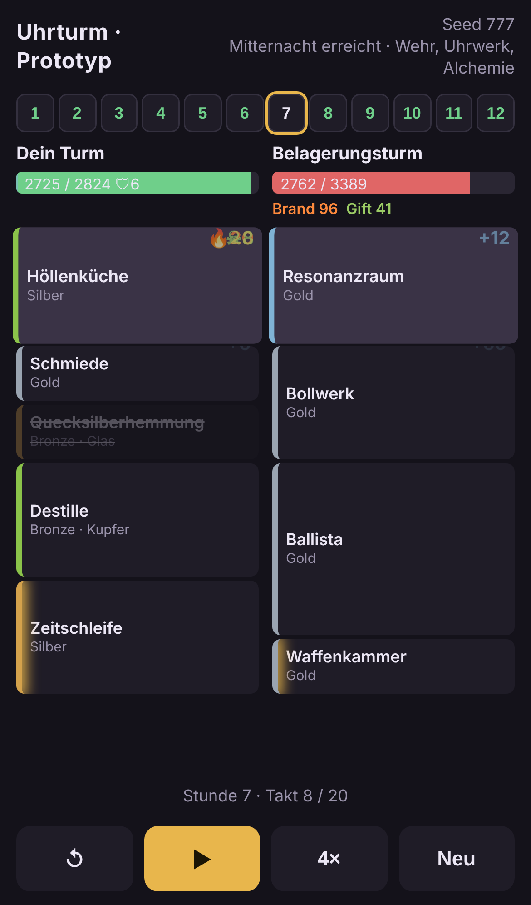

# Uhrturm (Arbeitstitel)

Sequenzieller Auto Battler für Smartphones im Hochkantformat, inspiriert von The Bazaar und Loop Hero.
Ein Funke läuft durch deinen Turm und löst Raum für Raum aus. Der Build ist der Loop.

- Konzept: [docs/konzept-brainstorm.md](docs/konzept-brainstorm.md)
- Befunde aus dem Prototyp: [docs/prototyp-befunde.md](docs/prototyp-befunde.md)
- Letzter Simulationsbericht: [sim/output/report.md](sim/output/report.md)

## Prototyp

Reines JavaScript (ES-Module), keine Abhängigkeiten, Node 20 oder neuer.

```bash
npm test                         # Kernmechaniken prüfen
npm run sim                      # 200 Runs pro Bot simulieren, Bericht nach sim/output/report.md
node sim/simulate.js --runs 300  # mehr Runs
npm run viewer                   # http://localhost:5173/viewer/ (auch im Handy-Browser im selben Netz)
```

Der Viewer spielt einen Bot-Run Stunde für Stunde ab. `?seed=777` in der URL wählt einen festen Run.



## Aufbau

| Pfad | Inhalt |
|---|---|
| `src/rng.js` | Seedbarer Zufall |
| `src/content/` | Räume, Verschmelzungen, Legierungen |
| `src/engine/` | Kampf-Engine und Turm-Operationen |
| `src/run/` | Run-Loop (Werkstatt, Vorzeichen, Gegner) und Bots |
| `sim/` | Simulation, Bericht, Static-Server für den Viewer |
| `viewer/` | Hochkant-Ansicht im Browser |
| `test/` | Tests mit `node:test` |
