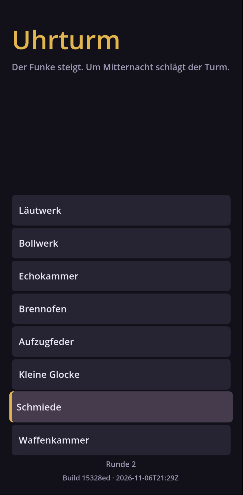

# Uhrturm

Sequenzieller Auto Battler fürs Handy im Hochformat, inspiriert von The Bazaar und Loop Hero.
Ein Funke läuft durch deinen Turm und löst Raum für Raum aus. Der Build ist der Loop.

**Spielen:** https://uhrturm-62-83-23-90.sslip.io

- Design: [docs/DESIGN.md](docs/DESIGN.md)
- Entscheidungen: [docs/adr/](docs/adr/README.md)
- Messungen: [docs/balance/](docs/balance/2026-11-06-prototyp.md)
- Arbeitsweise für Claude: [CLAUDE.md](CLAUDE.md)

## Aufbau

| Ordner | Inhalt |
|---|---|
| `lab/` | Labor in TypeScript: Regeln, Bots, Simulation, Browser-Viewer. Referenz für alle Regeln. |
| `game/` | Godot-4.7-Projekt, das eigentliche Spiel. Inhalte in `game/data/content.json` |
| `tests/golden/` | Golden-Vektoren, die Labor und Spiel verbinden |
| `deploy/` | Container und Caddyfile für den vServer |
| `scripts/` | Godot-Installation, Web-Build, Hooks |

## Befehle

```bash
cd lab && npm ci && npm test && npm run sim:smoke # Labor
./scripts/install-godot.sh                        # Godot 4.7.2 nach ~/.local/bin
godot --headless --path game --script res://tests/run_tests.gd
./scripts/build-web.sh                            # Web-Export nach build/web
cd lab && npm run viewer                          # Labor-Viewer: http://localhost:5173/lab/viewer/
```


